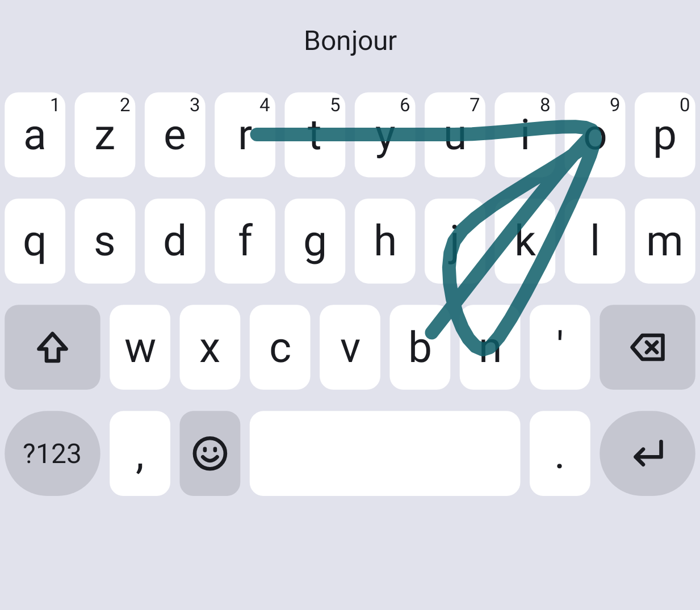

  

<h1 align="center">Synthboard</h1>

A swipe keyboard for Android that keeps what you type to itself.

<em>In active development.</em>

  <picture>
    <source media="(prefers-color-scheme: dark)" srcset="android/app/src/test/snapshots/swipe-dark.png">
    
  </picture>

I wanted to stop using Gboard, and nothing else swiped well enough to replace it, so I wrote this. It runs on my Pixel 9a under GrapheneOS, and it is the keyboard I type on every day. That daily typing is the only benchmark I trust.

## What it does

- **Swipe, in French and English at once.** You never switch language: the sentence tilts the ranking, and never rules a word out.
- **Reads the gesture with geometry and a very small network.** The network is 178 KB and runs on the CPU, on the phone, with no thread of its own.
- **Understands the sentence.** It uses word pairs and French verb agreement, and it can revise a word once the next one shows it was wrong.
- **Learns from you.** A word you correct leads for that gesture straight away, and a word you erase is taken back out of its memory.
- **Lets you fix one letter.** Backspace removes a character. Swipe again and the new word replaces what is left.
- **AZERTY and QWERTY,** with emoji, emoji search, and password managers through Android's inline suggestions.

## What it does not do

No permissions. No network code. No telemetry, analytics or cloud. It never reads the clipboard, and it never reads or learns from password fields.

What it learns is encrypted on the phone with a key that needs the phone unlocked, and it leaves memory when the keyboard closes. The release is checked for these promises before it is signed: [`tools/check-release.sh`](tools/check-release.sh) fails if one of them breaks. The threat model, with its known limits, is in [`docs/security.md`](docs/security.md).

## Under the hood

Almost everything is Rust. Kotlin stays a thin shell that draws, forwards touches and calls Android.

| Crate | Role |
|---|---|
| [`synthswipe`](crates/synthswipe) | The decoder: a trajectory, a layout and a lexicon in, ranked words out. It knows nothing about Android |
| [`synthswipe-onnx`](crates/synthswipe-onnx) | Runs the model with a minimal, static ONNX Runtime |
| [`synthboard-core`](crates/synthboard-core) | The keyboard: an event-driven state machine, with no timers |
| [`synthboard-ffi`](crates/synthboard-ffi) | The door to Kotlin, and the only `unsafe` code |
| [`synthboard-seal`](crates/synthboard-seal) | Encrypts traces and memory |

A full decode takes 2.3 ms on the Pixel 9a's big core and 14.5 ms on its smallest (p95, public gestures, without sentence context). The library carries BTI and PAC, and native memory is zeroed as it is freed.

## Status

This is a personal project, and it is still moving fast. Building it takes the datasets listed in [`PROVENANCE.md`](PROVENANCE.md) and a static ONNX Runtime from [`tools/build-ort.sh`](tools/build-ort.sh), so it is not a one-line build yet. The code is under the [Apache License 2.0](LICENSE). The word lists, the context table and the model are not: they come from data whose licences stop them being published as they are, so they stay out of this repository until they are replaced.

The rules every change follows are in [`AGENTS.md`](AGENTS.md). To help, read [`CONTRIBUTING.md`](CONTRIBUTING.md). What changed is in [`CHANGELOG.md`](CHANGELOG.md).
